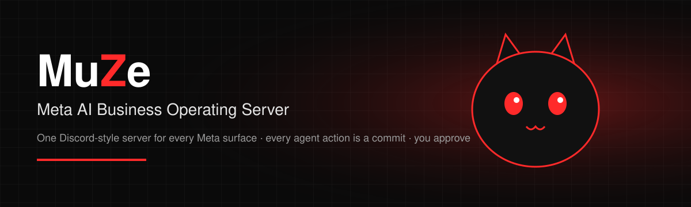
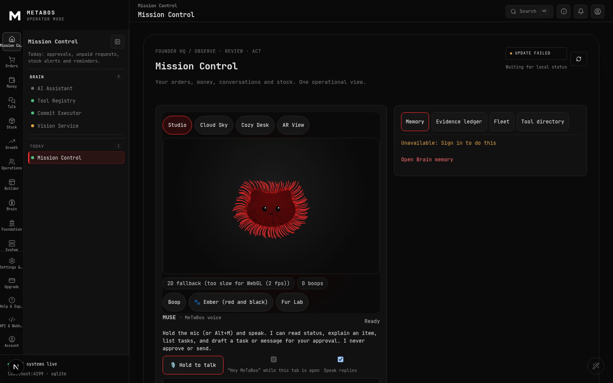
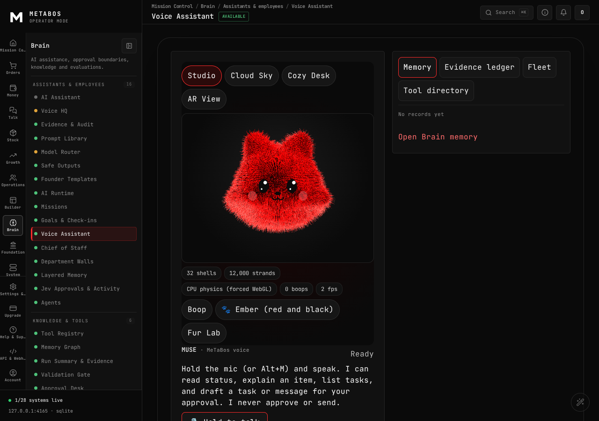
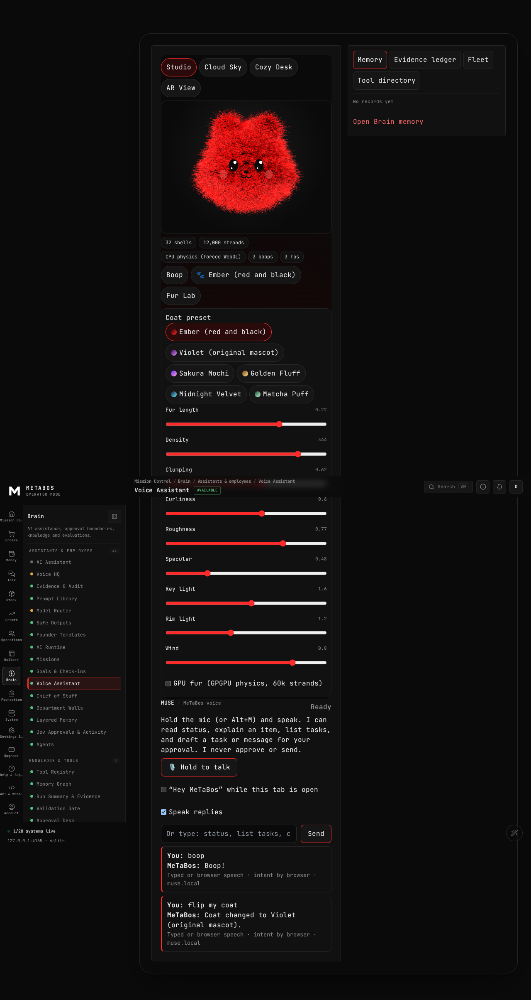
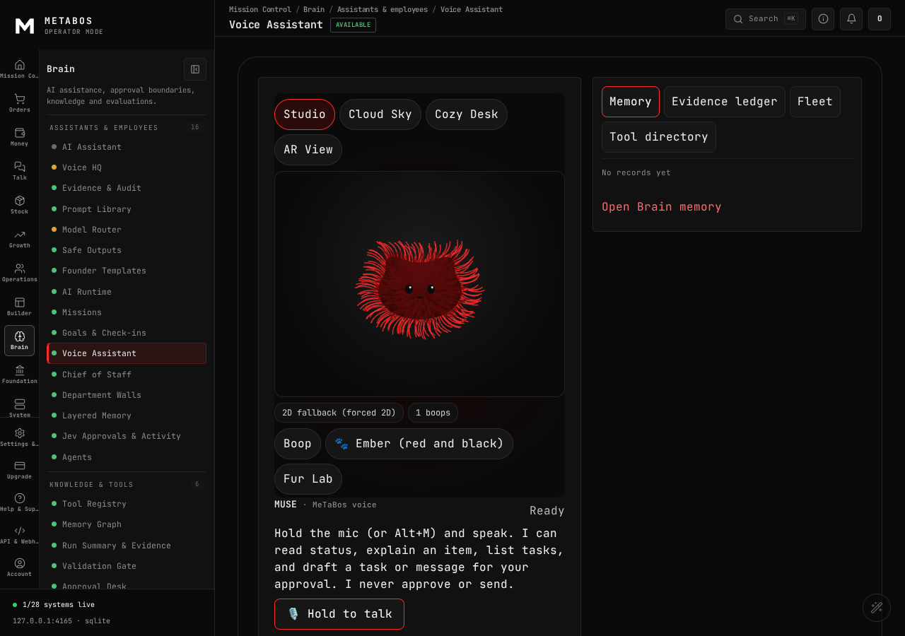
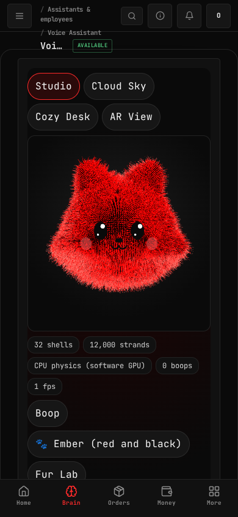
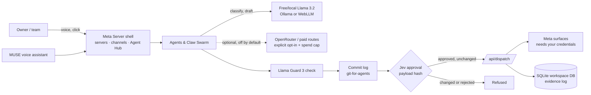

# MuZeBOS — Meta AI Zero Trust Business Open Server

**AI workers draft, you approve. Self-host or cloud.**

MuZeBOS (Meta AI Zero Trust Business Open Server) is an open-source, approval-gated workspace for Meta inbox drafts, invoicing, inventory, CRM and local Llama agents. Self-host it today; the hosted cloud option is **PLANNED**.

**Domain (coming soon):** workeragent.cloud — app.workeragent.cloud, docs.workeragent.cloud, api.workeragent.cloud are **PLANNED**; DNS is not live yet. Use this GitHub repo for now.

[](LICENSE)
[](https://github.com/CodesbyFebin/Meta-Ai-OS/actions/workflows/ci.yml)
[](https://github.com/CodesbyFebin/Meta-Ai-OS/actions/workflows/codeql.yml)
[](https://github.com/CodesbyFebin/Meta-Ai-OS/releases)

<p align="center"></p>

MuZeBOS is a **Next.js + SQLite** workspace for solo founders, creators and small agencies. AI agents only **propose**; every post, reply, ad draft or invoice is recorded as a commit and nothing is sent until a human approves the **exact payload**. It runs on your own machine, and by default it uses **free/local Llama models** (Ollama or in-browser WebLLM). Internal code names: **MeTaBos** / `muzebos` (the npm package and repo name are unchanged).

> **Status: single-operator preview, submitted to the Meta Global AI Developer Hackathon (Oct–Nov 2026) as MuZeBOS.** Not production-ready. Meta channels (WhatsApp, Instagram, Messenger, Facebook, Threads, Ads) show **Not connected** until you add your own credentials. See [Feature status](#feature-status).

## Table of contents
- [Screenshots](#screenshots) · [Quickstart (≈60 s)](#quickstart-60-seconds) · [Features](#feature-status) · [Architecture](#architecture) · [AI models](#ai-models-free-first) · [Safety model](#safety-model) · [Comparison](#how-muze-compares) · [FAQ](#faq) · [Roadmap](#roadmap) · [Contributing](#contributing) · [Citation](#citation) · [License](#license)

## Screenshots

*Mission Control right after `npm run dev` on a fresh clone, no keys configured (captured 2 Nov 2026 in headless Chrome; MUSE falls back to 2D without a GPU).*

[](docs/assets/muse-fur-studio.png)

| Fur Lab | 2D fallback | Mobile |
|---|---|---|
|  |  |  |

<!-- GIF slot: record the flow in DEMO-SCRIPT.md and save it as docs/assets/demo.gif, then replace this comment with  -->
A demo GIF is **PENDING** (script: [DEMO-SCRIPT.md](DEMO-SCRIPT.md)). Screenshots were taken in headless Chromium with software GL.

## Quickstart (≈60 seconds)
Tested on 2 Nov 2026 on Linux with Node 20.19 and a warm npm cache: clone → `npm ci` → first page served in **42 s**. A cold npm cache will take longer.

Requires **Node.js 22** (see `.node-version`; Node 20 works for the app but a few lab tests need Node 22) and git.
```bash
git clone https://github.com/CodesbyFebin/Meta-Ai-OS && cd Meta-Ai-OS
npm ci            # installs dependencies (incl. native better-sqlite3)
npm run dev       # opens http://localhost:4100
```
No API keys are needed to start: every provider shows **Not connected** until configured. Optional: `cp .env.example .env.local` and fill in only what you use ([docs/PROVIDER-ENV.md](docs/PROVIDER-ENV.md)). Never commit real keys.

Checks: `npm run typecheck` · `npm test` · `npm run build`.

## Feature status
Labels: **AVAILABLE** works locally with tests · **NEEDS CREDENTIALS** local records work, live send needs your provider account · **DEMO** offline/sample data · **PLANNED/PENDING** not built yet. The authoritative per-page list is generated from code: [docs/FEATURE-STATUS-MATRIX.md](docs/FEATURE-STATUS-MATRIX.md) (195 available, 43 needs-credentials, 7 existing, out of 245 pages).

| Feature | What it does | Status |
|---|---|---|
| Discord-style Meta Server shell | Brands as servers, Meta surfaces as channels, agents in the member list | AVAILABLE |
| Git-for-agents commit log | Every agent post/reply/ad draft is a commit with author, diff and status | AVAILABLE |
| Jev approval gate | Approval bound to a hash of the exact payload; changed payloads are refused | AVAILABLE (`tests/release-gate1-approval.test.ts`) |
| Unified inbox (WhatsApp, Messenger, Instagram, FB leads) | Drafts and records locally | NEEDS CREDENTIALS for live send |
| Social & ads drafts | Content calendar, ad drafts kept as drafts | NEEDS CREDENTIALS |
| Invoicing, GST, inventory, CRM, POS, bookings | SQLite-backed business modules with approval-bound invoices | AVAILABLE (local; no tax filing claimed) |
| UPI payment requests | Creates requests; settlement is manually reconciled and labelled | AVAILABLE (not a payment gateway) |
| Local Llama tier (Ollama) + WebLLM in browser | Free classification, drafting and short replies | AVAILABLE when Ollama/WebGPU is present |
| Llama Guard 3 (1B) check | Safety check before drafts reach Jev | AVAILABLE when the model is installed locally |
| MUSE voice assistant | Push-to-talk, reads data and drafts; cannot approve | AVAILABLE (browser Web Speech) |
| `docs/index.html` "Talk to MUSE" pitch page | Offline FAQ answers from `docs/muse-faq.json` | DEMO |
| Brain / ask-your-data | Fixed parameterised read-only SELECTs, no LLM invention | AVAILABLE |
| DPDP privacy export & redact | Export/pseudonymise customer data with evidence log | AVAILABLE |
| Provider dispatch adapters (payment links, dunning, ACH…) | Live provider actions | PLANNED (items stay queued) |
| Public docs site (GitHub Pages) | Static docs in `site/` | PENDING (not deployed) |
| Demo GIF | Recorded walkthrough | PENDING |

## Architecture

Deeper docs: [architecture & threat model](docs/METABOS-ARCHITECTURE.md), [API](docs/METABOS-API.md), [inference](docs/METABOS-INFERENCE.md), [docs index](docs/README.md).

## AI models (free-first)
| Route | Model | Cost | Default |
|---|---|---|---|
| Browser | Llama via [WebLLM](https://github.com/mlc-ai/web-llm) (WebGPU) | Free | Available when WebGPU is present |
| Local | `llama3.2:3b` via [Ollama](https://ollama.com) (`MUZEBOS_OLLAMA_URL`) | Free | Off until configured |
| Local safety | Llama Guard 3 1B | Free | Off until installed |
| OpenRouter | Any model you set in `MUZEBOS_OPENROUTER_MODEL` (free Llama variants available) | Free or paid, your choice | Off until configured |
| Paid hosted routes | Meta Model API / Baseten | Paid | **Off.** Need a key **and** `MUZEBOS_INFERENCE_PAID=1`, with per-workspace spend caps |

When a model is not reachable the app shows *Not connected* instead of fake output. Llama models are subject to the Llama Community License.

## Safety model
1. Agents only **propose**. Drafts pass Llama Guard 3 (when installed), then wait in Jev.
2. Jev approves the canonical hash of the exact payload; tampering after approval is refused.
3. Only approved, unchanged items reach `/api/dispatch`, and only to a connected sender.
4. MUSE can read and draft; voice approval is refused by design.
5. Spend is capped per workspace and per agent. Local audit hashes are not external attestations. See [SECURITY.md](SECURITY.md).

## How MuZeBOS compares
Honest positioning, not a benchmark. Check each product's own docs for current features.

| | MuZeBOS (this repo) | Meta Business Suite | Generic agent frameworks (e.g. LangChain apps) | Hosted helpdesk / CRM SaaS |
|---|---|---|---|---|
| Self-hosted, your data in local SQLite | Yes | No | Depends on you | No |
| Human approval bound to exact payload | Built in | No | You build it | Varies |
| Every AI action logged as a commit | Yes | No | You build it | Varies |
| Free/local Llama by default | Yes | n/a | Depends | Rarely |
| Live Meta sending out of the box | **No** (needs your credentials) | Yes | No | Varies |
| Maturity | Preview | Production | Varies | Production |

## FAQ
**What is MuZeBOS?**
MuZeBOS stands for *Meta AI Zero Trust Business Open Server*. An open-source, self-hosted AI business operating system: a Discord-style workspace where AI agents draft social posts, inbox replies, ads and invoices, and a human approves each exact payload before anything is sent.

**What does "zero trust" mean here?** no agent action runs without a human approving the exact payload hash (Jev gate); inbound webhooks are HMAC-signature-checked with constant-time comparison; paid AI routes are off unless you opt in. Encryption of stored provider tokens at rest is **PLANNED** — today credentials live in your own `.env`. No security certification.

**Is there a hosted version?** Not yet. workeragent.cloud is the planned domain (coming soon); DNS is not live.

**Is it free?** Yes, MIT-licensed. The default AI path uses free local models (Ollama, WebLLM). Paid routes are off unless you opt in.

**Does it send WhatsApp or Instagram messages automatically?** No. There is no auto-send or auto-approve path. Live sending also needs your own Meta app credentials; without them channels show *Not connected*.

**Which AI models does it use?** Llama 3.2 3B locally via Ollama, Llama in the browser via WebLLM, Llama Guard 3 1B for safety checks, and optionally any OpenRouter model you configure.

**Can I run it without a GPU or API keys?** Yes. The app, database and business modules run on plain Node.js. AI features show *Not connected* until a model is available.

**Where is my data stored?** In a local SQLite database on your machine. Cloud model providers, if you enable them, have their own retention rules.

**Is it production-ready?** No. It is a single-operator preview with no security certification. See [docs/RELEASE-READINESS.md](docs/RELEASE-READINESS.md).

**Is it affiliated with Meta?** No. Meta, Facebook, Instagram, Messenger, WhatsApp, Threads and Llama are trademarks of Meta.

## Roadmap
- [x] Jev payload-bound approvals, commit log, SQLite business modules (AVAILABLE)
- [x] Optional local Llama tier and Llama Guard check (AVAILABLE)
- [ ] Green CI on every push (in progress in this PR)
- [ ] Demo GIF and deployed docs site (PENDING)
- [ ] Meta webhook ingestion and live sends behind Jev with real credentials (PLANNED)
- [ ] Provider dispatch adapters for the 43 needs-credentials pages (PLANNED)
- [ ] Multi-user accounts and hosted deployment guide (PLANNED)

Track work in [Issues](https://github.com/CodesbyFebin/Meta-Ai-OS/issues) (look for `good first issue`).

## Contributing
Contributions are welcome. Read [CONTRIBUTING.md](CONTRIBUTING.md) and the [Code of Conduct](CODE_OF_CONDUCT.md), and report vulnerabilities privately per [SECURITY.md](SECURITY.md). Questions and ideas go to [Discussions](https://github.com/CodesbyFebin/Meta-Ai-OS/discussions).

## Hackathon disclosure
This project was submitted to the Meta Global AI Developer Hackathon under the name **MuZeBOS** (Meta AI Zero Trust Business Open Server). The first commit imports pre-existing code from before the 26 Oct 2026 kickoff (including a FounderOS fork, MIT). This repo's history was re-sequenced from [CodesbyFebin/MuzeBOS--The-Zero-Trust-Business-OS](https://github.com/CodesbyFebin/MuzeBOS--The-Zero-Trust-Business-OS); commit dates are assembly time, not backdated. Details: [HACKATHON.md](HACKATHON.md). Earlier verification results: [docs/VERIFICATION-REPORT.md](docs/VERIFICATION-REPORT.md). Previous README: [docs/METABOS-README.md](docs/METABOS-README.md).

## Third-party credits
See [THIRD_PARTY.md](THIRD_PARTY.md) and [THIRD_PARTY_NOTICES.md](THIRD_PARTY_NOTICES.md): FounderOS (MIT), agentshield, ai-employees, founder-skill, ai-agent-onboarding (licences in `vendor/`), three.js (MIT). Not affiliated with or endorsed by Meta.

## Citation
If you reference MuZeBOS in research or writing, use [CITATION.cff](CITATION.cff) (GitHub shows a "Cite this repository" button):
```bibtex
@software{francis_muzebos_2026,
  author = {Francis, Febin},
  title  = {MuZeBOS: Meta AI Zero Trust Business Open Server},
  year   = {2026},
  url    = {https://github.com/CodesbyFebin/Meta-Ai-OS},
  license = {MIT}
}
```

## License
[MIT](LICENSE). Includes code from FounderOS (MIT); see [THIRD_PARTY.md](THIRD_PARTY.md). Maintained by Febin Francis ([@CodesbyFebin](https://github.com/CodesbyFebin)), Kochi, Kerala, India.
